<p align="center">
  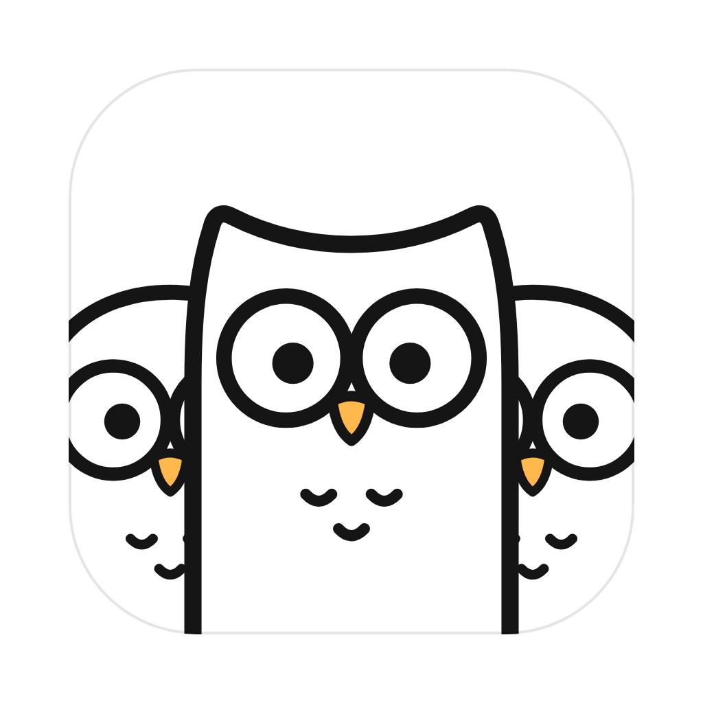
</p>

<h1 align="center">Owlto</h1>

<p align="center">
  A team of coding owls on your Mac.<br>
  Tell one owl what you need. It hands the work to the others and tells you how it went.
</p>

<p align="center">
  <a href="https://github.com/jackeydou/Owls/releases"><b>Download for macOS</b></a>
</p>

---

Owlto is a desktop app for people who use AI coding agents. Instead of juggling
several terminal windows, you chat with one **Router** owl. It plans the work,
sends each part to a **worker** (Claude Code, Codex, or Cursor), keeps an eye on
them, and comes back with one clear answer.

Several workers can work on the same project at the same time without stepping
on each other's toes, and you can look in on any of them whenever you like.

## Meet the owls

| | Owl | What it does |
| :---: | --- | --- |
| 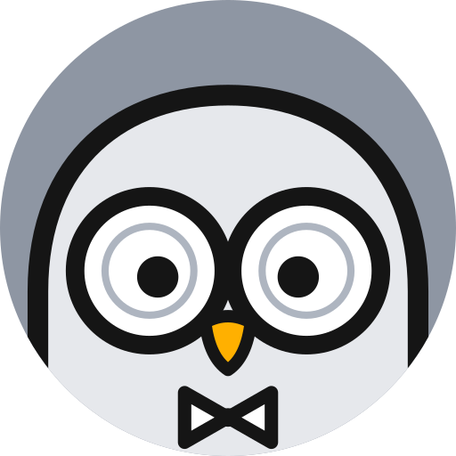 | **Router** | The one you talk to. Plans the work, picks the right workers, and sums up what they did. |
| 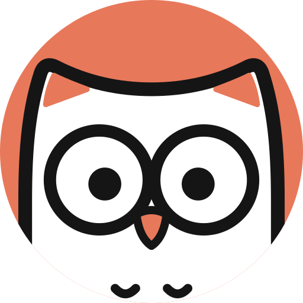 | **Claude Code** | A worker powered by Claude Code on your Mac. |
| 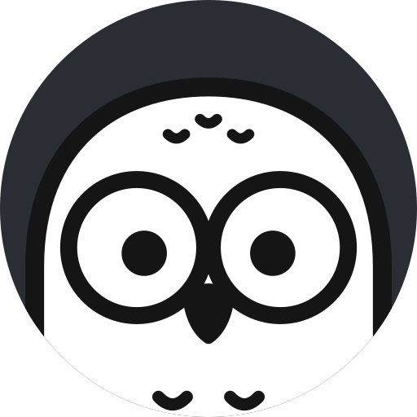 | **Codex** | A worker powered by Codex on your Mac. |
| 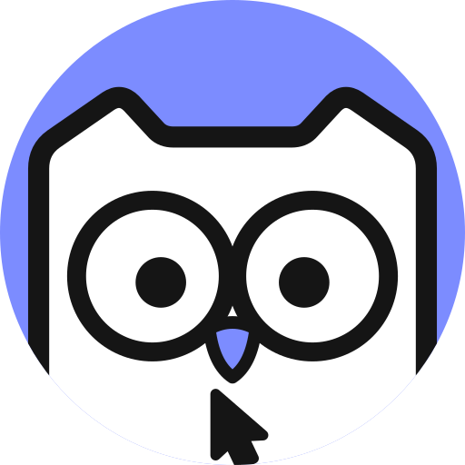 | **Cursor** | A worker powered by Cursor on your Mac. |
| 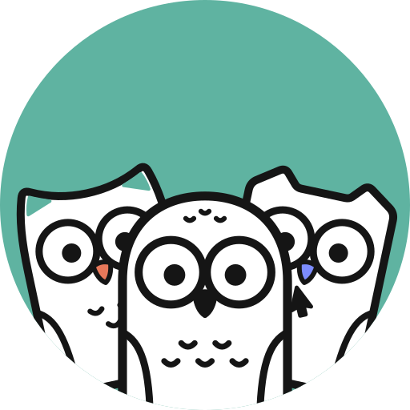 | **The team** | Big jobs get split across several owls working side by side. |

When an owl is busy, you'll see it typing away on its laptop:

<p>
  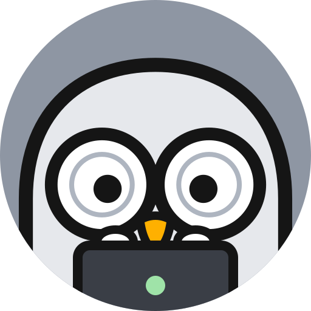
  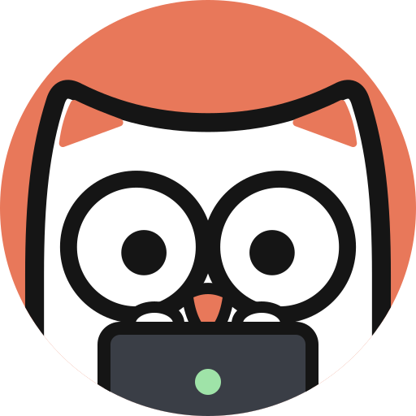
  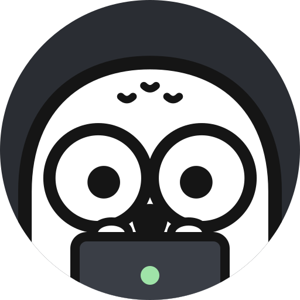
  
</p>

## Features

- **One chat for everything.** Describe what you want in plain words. The Router
  decides who should do it and reports back when it's done.
- **Many workers at once.** Each worker gets its own copy of your project, so
  several can change code at the same time without conflicts.
- **Mention a worker directly.** Type `@` to pick a project for a conversation
  or to talk to one worker yourself.
- **See every worker's story.** Open a worker to read its report first, then
  everything it did along the way, with a summary of changed files and a
  side-by-side view of each change.
- **Open in your favorite app.** Jump from a worker straight into VS Code,
  Cursor, Zed, Xcode, JetBrains IDEs, Finder, Terminal, Ghostty, and more.
- **Overview map.** See all your projects and owls on one board and check who is
  working, waiting, or done. Press `⌘J` to switch between the chat and the map.
- **Approvals you control.** When an owl wants to do something that needs your
  OK, the request waits right above the message box.
- **Projects made easy.** Open a folder, clone a GitHub repository, or start an
  empty project in one click. Give each project its own icon, color, and notes
  for the workers.
- **Pull requests in one place.** See every pull request your owls opened, with
  merge, review, and check status, and sort by what needs your attention.
- **Knowledge cards and whiteboards.** Save useful answers as cards, sort them
  with tags, lay them out on boards, and attach them to new messages. Press `⌘K`
  to open your cards.
- **Usage at a glance.** See how much of each agent's plan you have left, and
  browse daily usage and estimated cost in Settings.
- **Updates itself.** Owlto checks for new versions in the background and offers
  to restart when one is ready. Choose the stable or beta channel.
- **Make it yours.** Light and dark themes, English and Simplified Chinese, and
  nine owl logos for your Dock.

<p>
  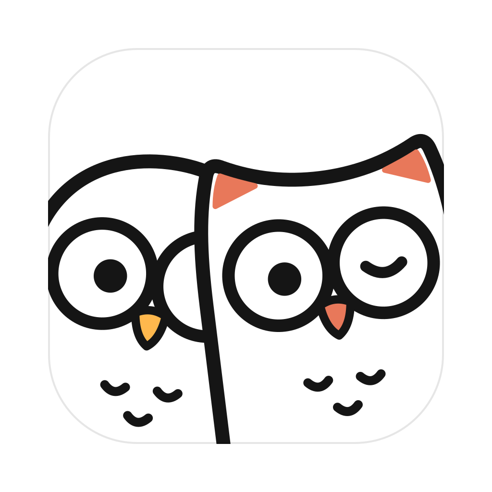
  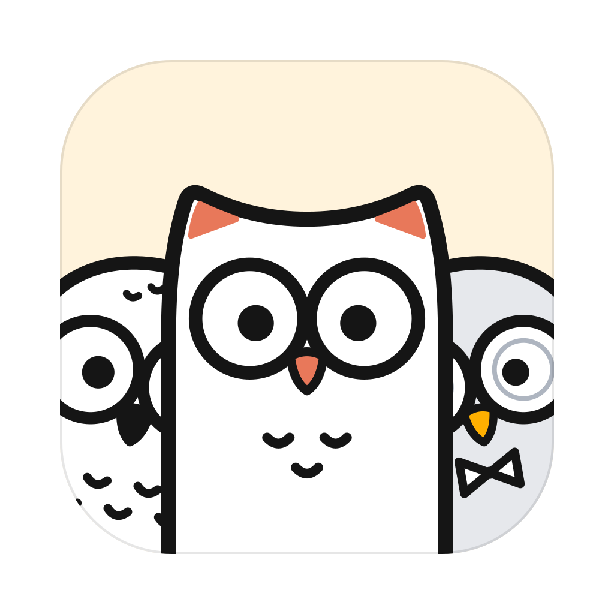
  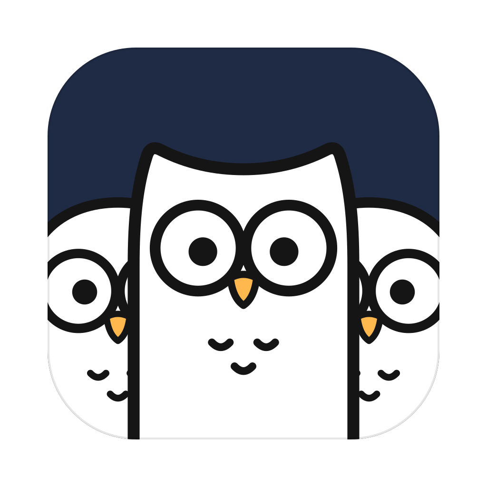
</p>

## Install

1. Go to the [Releases page](https://github.com/jackeydou/Owls/releases) and
   download the latest `.dmg` file.
2. Open the file and drag **Owlto** into your **Applications** folder.
3. Open Owlto from Applications or Launchpad.

You need a Mac with Apple silicon (M1 or later) running macOS 13 Ventura or
later.

## Get started

### 1. Install at least one coding agent

Owlto works with the coding agents you already use. Install one or more of them
and sign in once in Terminal:

**Claude Code**

```bash
curl -fsSL https://claude.ai/install.sh | bash
claude
```

Follow the prompts to sign in, then quit with `/exit`.

**Codex**

```bash
brew install --cask codex
codex
```

Sign in with your ChatGPT account when asked. You can also sign in later from
Owlto.

**Cursor**

```bash
curl https://cursor.com/install -fsS | bash
cursor-agent login
```

Cursor can work as a worker, but not as the Router.

### 2. Connect it in Owlto

Open **Settings** (`⌘,`) → **Agents**, choose the agent's tab, and click
**Connect local …** (for example, **Connect local Claude Code**). Owlto finds
the agent on your Mac and shows the account you're signed in with.

Then open **Settings → Router & Workers** to choose which agent runs the Router
and which one your workers use by default.

### 3. Start a conversation

- Press `⌘N` for a new conversation and tell the Router what you need.
- Type `@` to choose a project. Tasks that don't belong to a project run in a
  workspace folder (`~/Owlto/Workspace` unless you pick another one in Settings).
- Click a worker to see what it's doing, or press `⌘J` to see everything on the
  map.

> Only open projects you trust. Your coding agents may follow instructions and
> settings stored inside a project.

## Privacy

Owlto runs on your Mac and uses the agents you installed and signed in to
yourself. It never copies your passwords or sign-in tokens; it only reads your
account status to show who you're signed in as.

## Feedback

Found a bug or have an idea? [Open an issue](https://github.com/jackeydou/Owls/issues).
Please don't include passwords, private code, or other personal data. Report
security problems privately.

Want to help build Owlto? See [CONTRIBUTING.md](CONTRIBUTING.md).

## License

Owlto is licensed under the [GNU Affero General Public License v3.0](LICENSE).
Claude Code, Codex, and Cursor are installed separately and follow their own
terms.
