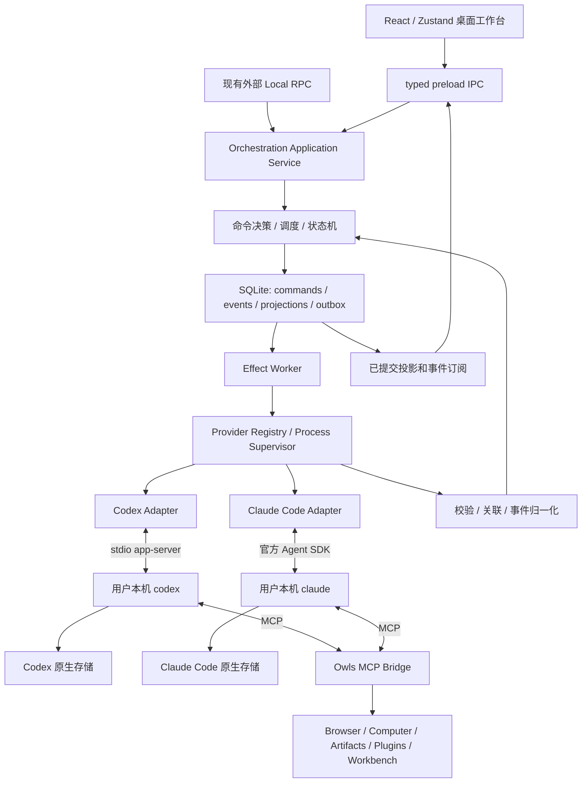
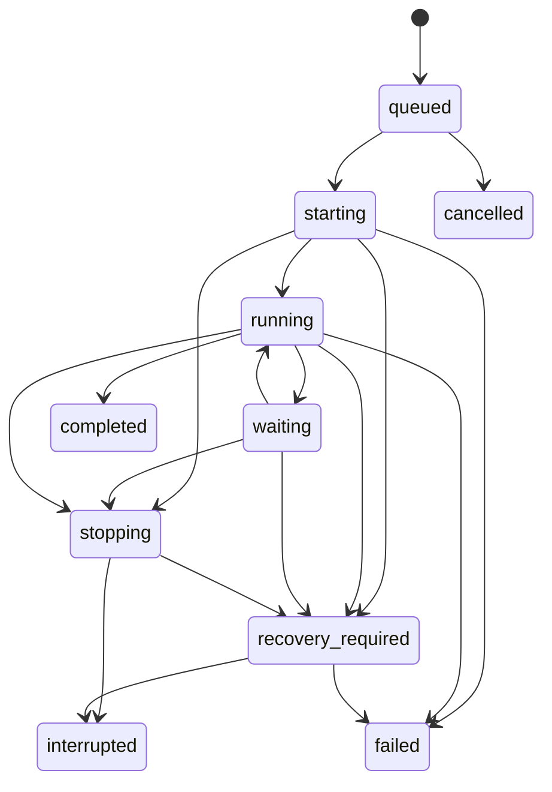

# RFC: Owls 本地 Agent Orchestrator 重构方案

状态：重构设计基线。完整双引擎方案待架构评审；当前已实施 Codex-first 主流程。

当前实施范围已由后续要求收敛为 Codex-first：使用本机 app-server，重做主流程和设置页，不保留旧数据，不做向后兼容。具体实现见 [Codex runtime](CODEX_APP_SERVER.md)。本文的旧数据迁移和双 provider 阶段属于原始提案，不是当前实施约束。

日期：2026-10-31。

Owls 基线：`e9a295b65de0a20a742c2ee85532bd30d556fe8c`。
t3code 参考基线：`50c1c5dc536493826fc66e220598f38b831d5bde`。
外部协议以实施时支持的 CLI 版本及官方文档为准。

## 1. 决策摘要

将 Owls 从“基于 pi、自主管理 agent runtime 的桌面 agent”转为“管理用户本机 coding agents 的桌面编排器”。

Claude Code 和 Codex 负责模型请求、agent loop、原生工具、上下文、压缩、原生子 agent、原生权限执行和原生会话恢复。Owls 负责项目、工作区、任务调度、桌面交互、统一历史、跨 agent 交接，以及 Owls 自有能力的接入和授权。

推荐方案：

1. **Codex：启动用户安装的 `codex app-server`，通过 stdio 控制。**
2. **Claude Code：使用官方 Agent SDK 作为协议客户端，显式指定用户安装的 `claude`。** SDK 不得静默回退到随包二进制。
3. 保留 Electron、React、Zustand、preload IPC、SQLite/Drizzle 和桌面能力。首轮不迁移到 t3code 的服务端技术栈。
4. 建立 provider-neutral 的编排契约。原生事件只在 adapter 内解析，不再把 pi 或其他厂商事件直接发给 renderer。
5. SQLite 管理 Owls 产品数据、执行意图、事件和展示投影；CLI 的原生存储负责恢复 agent 上下文。两者有不同职责。
6. 通过 MCP Bridge 向两个 agent 提供 Owls 工具。原生 shell、文件工具不再绕回 pi 工具实现。
7. 保留旧 pi 会话和用户数据，通过显式上下文交接进入新引擎，不伪造原生恢复。
8. 分阶段替换所有 pi 执行入口，最终移除 pi 运行时依赖。开发兼容层不成为长期第三个 provider。
9. 正式稳定版必须通过现有功能迁移验收。需要删除或暂停的现有功能先作产品评审，不在实现中静默下线。

本文获接受后，应取代 [旧 runtime RFC](RFC_PICHU_AGENT_RUNTIME.md) 中“自主管理完整 agent runtime”的目标。插件格式、历史数据和发布协议仍需按既有对外契约逐项迁移。

## 2. 产品范围

用户已在本机安装并登录 Claude Code 或 Codex。打开 Owls，选择项目、工作区、agent 及其支持的模型，开始任务。

目标工作台包含多项目、并行任务、可选 Git worktree、流式对话、工具活动、计划、diff、审批、提问、重启后继续、Browser、Computer Use、插件、附件、artifacts 和自动化。任务可在两个引擎之间明确交接。

| 项目 | 默认决定 |
| --- | --- |
| 首批引擎 | Claude Code、Codex，均为正式支持目标 |
| 安装来源 | 用户本机安装；自动发现或显式选择路径 |
| 账号 | 首版每种引擎接入一个默认本机配置；多账号后续设计 |
| 系统 | macOS 优先验收；保留 Windows/Linux 构建，分别验证 provider |
| 执行位置 | 本机；本轮不做远程服务器、云执行或移动端 |
| 宿主 | main 组合编排服务，provider 使用子进程；不增加必需的常驻 daemon |
| pi | 迁移窗口内隔离使用，最终退出运行时 |
| BYOK | 主聊天配置交给 CLI；已有加密配置保留为 legacy 数据 |
| 现有功能 | 逐项迁移，不能把编排器理解成只保留聊天 UI |

工作区管理和统一任务状态属于核心范围。自动跨引擎团队调度、多账号、远程设备和原生插件格式互转不是首个核心 Beta 的前置条件。正式稳定版的功能删减需另行确认。

## 3. 当前架构和耦合

### 3.1 已核实的模块

| 当前模块 | 耦合或职责 | 改造方向 |
| --- | --- | --- |
| `agent/index.ts`、`types.ts` | 创建 Agent、prompt、恢复、hooks、运行时 map | 替换成编排服务和 provider session manager |
| `agent/prompt-flow.ts`、`detached-prompt-flow.ts` | 主聊天、队列、无 UI 执行 | 统一提交 command |
| `agent/event-persistence.ts`、`message-utils.ts` | 解析 pi 事件并写消息 | 领域事件 reducer 和投影 |
| `ipc-handlers/context-compaction.ts` | 自主管理模型上下文 | 新引擎交给 provider；保留旧 marker reader |
| `preload/index.d.ts` | AgentEventPayload 直接依赖 pi AgentEvent | Owls 自有 schema/type |
| renderer `stores/session/*` | 按 pi 事件更新文本、工具卡片、队列 | 按 session/item 的统一投影 |
| `tools/index.ts`、`tools/coding.ts` | 组合编码、插件、桌面 tools | 编码 tools 交 CLI；Owls tools 改 MCP |
| `tool-approval-*`、`tool-auto-reviewer.ts` | 最终 gate、审批规则、模型审核 | 拆分原生审批代理与 Owls 授权 |
| `plugins/*`、`skill-loader.ts` | 安装、MCP、skills、hooks、账号和数据 | 保留安装/数据层，重做 exposure |
| `multi-agent/team-manager.ts` | 直接创建 pi Agent | 改成调度任务；原生子 agent 单独映射 |
| `cron/*` | 定时调度，通过 detached prompt 执行 | 保留 scheduler，替换 runner |
| `agent/session-title.ts` | 使用 pi 发辅助模型请求 | 首版确定性标题，后续有边界的辅助请求 |
| `db/schema.ts`、`stores/settings-store.ts` | sessions、messages、runs、审批、HITL、设置 | 增量迁移，保留历史行 |
| `session-transfer.ts`、`session-inspector.ts` | 导入、分享、轨迹、Codex JSONL 检查 | 区分展示导入和 native resume |
| `background-terminals.ts` | Owls 后台终端 | 保留，与 provider 命令分开归属 |
| `browser-use/*`、`local-rpc/*` | 浏览器与外部本地控制面 | 复用服务；MCP 不转发全部 RPC |
| `workbench/*`、`sop/*`、附件、artifacts | 产品能力，部分工具外壳依赖 pi | 保留服务，去除 pi tool 类型 |
| `tools/image-generation.ts` | 独立图片配置，tool 外壳依赖 pi | 保留服务和凭证边界，改 MCP |

main 路径相对 `apps/pichu-client/src/main/`。pi 类型还出现在 shared、preload 和 renderer，整改不止替换 `new Agent()`。

当前项目索引主要是设置中的路径记录。产品级 workspace/worktree 所有权需要新增模型，不能把开发 profile 的 worktree 识别当成已有工作区管理。

### 3.2 当前执行路径

`Renderer → preload → agent IPC → Owls Agent → pi loop → Owls tools/approval → SQLite`。

当前可从 SQLite messages 重建 pi AgentMessage。新架构不能保留这一假设：规范化历史足以展示和交接，不足以还原 Claude Code/Codex 的原生上下文和运行状态。

## 4. 从 t3code 借鉴的边界

以下归纳来自固定参考提交；Owls 的实现选择是本方案的建议。

| t3code 设计 | Owls 采用的原则 |
| --- | --- |
| provider adapter | 隔离厂商协议，领域层和 UI 不按 provider 名称分支 |
| Codex app-server、Claude Agent SDK | 使用正式控制接口，保留原生 harness |
| capabilities | 显式表达 fork、steer、审批、恢复等差异 |
| command/event/projection/outbox | 事务保存意图，再执行外部动作，提交后发布 |
| app thread 与 provider thread 分离 | Owls sessionId 不等于原生 ID |
| context handoff | 跨引擎是交接，不是完整原生上下文恢复 |
| 真实协议 replay | 用实际录制验证 adapter，不只手写理想事件 |

出处：[架构](https://github.com/pingdotgg/t3code/blob/50c1c5dc536493826fc66e220598f38b831d5bde/docs/internals/overview.md)、
[provider 接入](https://github.com/pingdotgg/t3code/blob/50c1c5dc536493826fc66e220598f38b831d5bde/docs/internals/adding-a-provider.md)、
[capabilities](https://github.com/pingdotgg/t3code/blob/50c1c5dc536493826fc66e220598f38b831d5bde/docs/orchestration-v2/provider-capability-system.md)、
[上下文交接](https://github.com/pingdotgg/t3code/blob/50c1c5dc536493826fc66e220598f38b831d5bde/docs/internals/context-handoffs.md)。

不照搬 Effect、全量数据库模型、网络 RPC、多环境连接层或移动端。Owls 已有产品和数据，首轮收益来自执行边界变化。引入整套框架会把 provider 迁移变成第二次技术栈迁移。

不照搬其环境变量配置方式。新增 runtime 配置继续通过 settings store 和 bootstrap/path flow。

若复用源码，保留 t3code MIT 声明；优先参考协议和设计，不直接搬入上万行 adapter。本次不改变 Owls 许可证。

## 5. 目标架构



### 5.1 所有权

| 能力 | 负责方 |
| --- | --- |
| 模型请求、认证续期、配额、基础 system prompt、上下文/压缩 | 原生 CLI |
| 原生文件、shell、搜索和子 agent 执行 | 原生 CLI |
| 原生权限、sandbox、原生插件和 hooks | CLI；Owls 代理其明确暴露的审批 |
| 项目、工作区、任务、队列、并发、工作区锁 | Owls |
| 桌面会话索引、历史、搜索、归档、通知、审计 | Owls |
| native IDs | CLI 产生，Owls 保存 opaque 引用 |
| Browser、Computer、artifacts、产品 tools | Owls，经 MCP 授权和执行 |
| Owls 插件安装、凭证与 data | Owls |
| 跨引擎交接和任务协调 | Owls；不共享可变原生上下文 |

### 5.2 模块目录

先在 app 内建立边界，不急于拆 workspace package：

```text
src/shared/orchestration/
  commands.ts
  events.ts
  views.ts
  providers.ts
  schemas.ts
src/main/orchestration/
  application-service.ts
  command-handler.ts
  reducer.ts
  scheduler.ts
  effect-worker.ts
  recovery.ts
  context-handoff.ts
  persistence/
src/main/providers/
  registry.ts
  executable-discovery.ts
  process-supervisor.ts
  provider-adapter.ts
  codex/
  claude-code/
src/main/agent-bridge/
  mcp-server.ts
  session-capabilities.ts
  tool-catalog.ts
  plugin-exposure.ts
src/main/workspaces/
  workspace-store.ts
  git-service.ts
  workspace-locks.ts
```

编排领域不直接依赖 Electron、pi、Claude SDK、Codex wire types 或插件 ID。IPC 和 Local RPC 是 application service 的适配层。只有存在真实隔离或复用需求时，再抽独立 package/utility process。

## 6. 统一领域契约

### 6.1 对象与关联

| 对象 | 含义 |
| --- | --- |
| Project | 用户登记的项目，首轮复用 project store |
| Workspace | 实际执行目录，原目录或 Owls 管理的 worktree |
| Session | Owls 中的会话，保留现有 sessionId |
| ProviderInstance | 引擎的可执行文件和本机配置身份，首版各一个 |
| ProviderBinding | Session 与原生 thread/session 的绑定及配置快照 |
| Run | 一次用户请求或自动化执行 |
| RunAttempt | 某 Run 的具体启动尝试，不等同自动重发 |
| ProviderTurn | 原生一轮；一个 Run 可关联多个原生 turns |
| Item | 助手消息、命令、工具、文件变更、计划等 |
| RuntimeRequest | 审批、提问和其他外部响应请求 |
| SessionLink | 交接、side conversation、fork 的显式关系 |

关联链至少包含：

- `sessionId → bindingId → nativeSessionId/nativeThreadId`。
- `runId → attemptId → nativeTurnId`。
- `itemId → nativeItemId/toolUseId`。

缺少原生 ID 时 adapter 分配稳定映射并标记可靠性，不能按当前选中会话推断归属。原生子 agent 的迟到事件按其原生身份关联，不能记到当前新 Run。

### 6.2 Adapter 轮廓

以下是 Owls 建议契约，不是 vendor API。具体输入输出在 P1 用 schema 固化。

```ts
type ProviderKind = 'codex' | 'claude-code'

type FeatureSupport =
  | { status: 'supported' }
  | { status: 'unsupported'; reasonCode: string }
  | { status: 'unknown' }

type ProviderCapabilities = {
  schemaVersion: 1
  resume: FeatureSupport
  interrupt: FeatureSupport
  activeSteering: FeatureSupport
  nativeFork: FeatureSupport
  planMode: FeatureSupport
  imageInput: FeatureSupport
  nativeHistoryRead: FeatureSupport
  subagentEvents: FeatureSupport
  supportedPermissionModes: ProviderPermissionMode[]
}

type NativeResponseRoute =
  | { kind: 'live-rpc'; connectionEpoch: string; requestId: string }
  | { kind: 'live-callback'; connectionEpoch: string; callbackId: string }
  | { kind: 'message'; bindingId: string }

interface ProviderAdapter {
  readonly kind: ProviderKind
  inspectInstallation(input: InspectInstallationInput): Promise<InstallationStatus>
  openSession(input: OpenProviderSessionInput): Promise<ProviderSessionHandle>
  resumeSession(input: ResumeProviderSessionInput): Promise<ProviderSessionHandle>
  startTurn(input: StartProviderTurnInput): Promise<TurnDispatchResult>
  interrupt(input: InterruptProviderTurnInput): Promise<InterruptReceipt>
  respond(input: RespondToRuntimeRequestInput): Promise<ResponseDispatchResult>
  closeSession(input: CloseProviderSessionInput): Promise<void>
  subscribe(listener: (event: ProviderEvent) => void): () => void
}
```

契约约束：

- ProviderEvent 是校验过的闭合 union；未知原生 frame 不直接透传 UI。
- 模型、effort 和权限是 provider 提供的选项，不强行复用 pi thinking 枚举。
- 模型选择使用 `instanceId + nativeModelId`，防止同名冲突。
- provider 专有设置在 adapter 的版本化 schema 内，领域层不拼接 flags。
- 订阅在启动请求前建立，防止事件早于 startTurn response 到达。
- fork、steer、压缩、历史读取按 capability 提供扩展接口。unknown 不作为可用。
- 错误使用稳定代码，如 `not_installed`、`auth_required`、`usage_limited`、
  `unsupported_version`、`native_session_missing`、`dispatch_unknown`。

能力表必须随 adapter/CLI 版本固化。下表是官方接口提供的接入候选，不代表本次已经实测通过：

| 能力 | Codex 路径 | Claude Code 路径 | Owls 对外语义 |
| --- | --- | --- | --- |
| 原生恢复 | thread/resume | SDK resume | 必需，原生数据丢失则明确失败 |
| 实时文本 | item/message delta | partial message | 必需，按 item 归一化 |
| 中断 | turn/interrupt | SDK interrupt | 必需，单测与真实 fixture 覆盖启动竞态 |
| 审批 | server request | SDK permission callback | 保留原生选项与有效范围 |
| 提问 | 版本对应 RPC/消息请求 | SDK question/dialog | 按实际响应 route，不混淆持久性 |
| active steering | turn/steer，按版本验收 | 不能将 streaming input 自动等同 steer | 未确认时排队 |
| 原生 fork | thread/fork | SDK fork 能力 | 验证 cwd 和存储身份，否则 handoff |
| 模型/effort | model/list 的实时选项 | SDK 公开查询/初始化信息 | 不硬编码“最新模型”，未知时保留原生默认 |
| subagent/后台工作 | 原生事件，按版本 | SDK task/subagent 事件，按版本 | 能看见多少展示多少，不伪造树结构 |
| sandbox 强度 | Codex 实际生效策略 | Claude 实际生效策略 | 与审批模式分开显示，不声称两者等价 |

### 6.3 事件和状态机

至少定义：

`session.created`、`binding.attached`、`run.queued`、`run.started`、
`item.started`、`item.updated`、`item.completed`、
`runtime-request.opened`、`runtime-request.resolved`、
`run.completed`、`run.failed`、`run.interrupted`、
`binding.disconnected`、`handoff.created`。

持久化 envelope 包含 schemaVersion、全局递增 sequence、eventId、sessionId、
runId/bindingId（可空）、occurredAt 和 typed payload。时间用于展示，sequence 决定顺序，不用文本相似度去重。



其他状态独立建模：

- Connection：`starting | ready | disconnected | closed`。
- RuntimeRequest：`pending | answering | resolved | expired | unavailable`。
- 账号/限额阻塞：稳定 reasonCode，resetAt 只使用 provider 实际报告值。
- 原生后台工作：单独维护，不能因主 turn 结束就杀掉有工作进程。

一个 Run 可有多个并发审批或提问。旧 HITL 的单 session 单 pending 约束只用于旧数据。Run 是否 waiting 取决于仍然阻塞的请求；异步提问不一定阻塞。

### 6.4 调度、队列与取消

一个 Binding 同时最多一个 Owls 启动的前台 Run，不同 Session 可以并行。后续消息由 Owls 持久化排队，首版不再启用另一套 provider 消息队列。

active steering 仅在 capability 验收后开放，不支持时显示排队，不能静默 interrupt 后重发。用户发送后立即 Stop 时，先记录取消意图，等原生 turn 可定位后补发中断，不能因暂缺 nativeTurnId 丢掉取消。

区分停止当前轮和取消剩余队列，明确原生后台工作的停止范围。初始全局并发上限使用明确常量，P0 实测后定值。等待审批不自动释放原生连接；占满资源时展示真实排队原因。

审批、回答、取消、归档均校验 session/binding/run 归属与版本，不能从 renderer 当前状态推断。

### 6.5 IPC 与命令输入

新入口仍是 typed preload，不把内部 command bus 或 provider client 直接暴露成任意方法调用。

| API | 核心输入 | 返回 |
| --- | --- | --- |
| providers.list | 无 | 安装/账号状态的脱敏快照 |
| providers.inspectInstallation | instanceId | 有界探测结果，不创建 agent 会话 |
| providers.selectExecutable | instanceId、经用户选择的文件 | 校验后的配置与版本 |
| orchestration.createSession | commandId、workspaceId、instanceId、selection | receipt、sessionId |
| orchestration.send | commandId、sessionId、expectedRevision、text、attachmentIds | receipt、runId |
| orchestration.interrupt | commandId、sessionId、runId、scope | receipt |
| orchestration.respond | commandId、sessionId、requestId、typed response | receipt，原生接收另由事件确认 |
| orchestration.getSnapshot | sessionId、分页参数 | view、已提交水位 sequence |
| orchestration.onEvents | sessionId、afterSequence | 有取消订阅的已提交事件流 |
| workspaces.list/create | 项目与已验证的工作区选项 | workspace view |

所有外部输入在 main 用 shared schema 校验。attachmentIds 在 main 解析成已验证资源，
不让 renderer 直接声明原生可读文件、有效 workspace 或批准范围。
监听在 renderer unmount/切换 session 时清理；断线补读只补规范事件，不直接读原生存储文件。

adapter 遇到新增的观察类事件可忽略并计数，已有 item 用通用展示降级。
未知 control request 或改变权限的未知字段不能自动同意；必要契约不兼容时结束启动并返回 unsupported_version。

## 7. Codex 接入

### 7.1 控制协议

用发现的可执行文件和 argv 数组启动：

```text
<resolved-codex> app-server --listen stdio://
```

按行解析双向 JSON，管理 request ID、超时、server-initiated request 和取消生命周期。Codex wire format 省略 JSON-RPC 的 jsonrpc 字段，不能复用 Owls Local RPC 的完整 envelope。

完成 initialize/initialized，再调用 thread/start 或 thread/resume、turn/start、
turn/interrupt。模型来自 model/list，输出归一化为消息、命令、文件变更、审批和提问。

首版采用 stdio，不依赖实验性 WebSocket listener。根据支持的 CLI 生成并审阅协议类型，只保留需要的边界，不在用户启动时生成类型。[官方 App Server 文档](https://developers.openai.com/codex/app-server/)。

本机 CLI help 仍将 app-server 标为 experimental。使用官方公开协议不等于承诺跨版本稳定；兼容性清单、adapter 隔离和 replay 是发布条件。

### 7.2 进程与存储

首版每个活跃 Binding 启动一个 app-server，获得独立配置、MCP 注入和故障边界。空闲且无 pending request、原生后台工作的进程可以关闭，原生 thread 引用保留。

不接管用户其他 Codex 进程，不依赖桌面应用内部 daemon。以后仅在会话配置、MCP 凭证与故障隔离得到证明后，考虑按 instance 共享进程。

沿用用户本机配置和存储，不改 CODEX_HOME，不复制 token，不修改 rollout 文件。用户清理原生数据后，Owls 历史仍可读，resume 返回 native_session_missing。

### 7.3 审批和恢复

保存原生请求的选项 ID 与可用决策，UI 回答通过窄转换层交回当前连接。旧连接 RPC ID 不向新 app-server 重放。

区分阻塞 RPC 提问与版本支持的异步消息提问，后者通过提交消息回答；仅在原生语义允许时保留重启后的回答入口。

恢复 thread 不等于恢复正在执行的 turn。首版不承诺 app-server 被杀后原 turn 仍运行。恢复先核对原生 thread，再由显式继续操作启动下一轮，不自动重发上一条 prompt。

## 8. Claude Code 接入

### 8.1 SDK 控制本机 CLI

使用官方 `@anthropic-ai/claude-agent-sdk`，显式传入 pathToClaudeCodeExecutable。
保留 Claude Code preset，明确设置经验证的 settings sources。使用 streaming input 和 partial message、assistant、tool、result 及控制回调。

SDK 是本机 CLI 的客户端，不成为 Owls 自建 loop。保存 init 中原生 session ID，后续用 resume。审批和提问用所选版本 SDK 的 callback/dialog 接口映射到 RuntimeRequest。

[官方 TypeScript 契约](https://code.claude.com/docs/en/agent-sdk/typescript)、
[原生 sessions](https://code.claude.com/docs/en/agent-sdk/sessions)。

### 8.2 禁止捆绑回退

- 固定并验证 SDK 与本机 CLI 版本组合，写兼容性清单。
- 使用所选 SDK 公开的 bundling entry；使用 /core 前确认该版本提供。
- 用 pnpm 规则排除 SDK 平台 CLI optional packages，不编辑 node_modules。
- 打包检查证明安装包无隐藏 Claude CLI，所有启动指向选定的本机文件。
- 缺失或不支持时明确报错，不静默下载、安装或回退。

t3code 的 [Claude adapter](https://github.com/pingdotgg/t3code/blob/50c1c5dc536493826fc66e220598f38b831d5bde/apps/server/src/orchestration-v2/Adapters/ClaudeAdapterV2.ts) 使用 SDK 并支持 binaryPath；
其 [pnpm 配置](https://github.com/pingdotgg/t3code/blob/50c1c5dc536493826fc66e220598f38b831d5bde/pnpm-workspace.yaml) 排除了 SDK 平台二进制。

### 8.3 直接 stream-json 的取舍

`claude -p --input-format stream-json --output-format stream-json` 可用于结构化程序调用，但自建双向审批、interrupt 和 SDK control 协议会增加维护成本。

首选官方 SDK 适配本机 CLI。只有 P0 证明这条路不满足安装或交互要求时，再评审直接协议 adapter，不用终端文本解析作 fallback。[官方 headless 文档](https://code.claude.com/docs/en/headless)。

### 8.4 账号、配置和权限

沿用用户本机认证。Owls 不自建 Claude OAuth、不收集 token、不代理计费。需要登录时引导用户完成官方 CLI 流程。

不默认 --bare：官方文档说明 bare mode 不读取订阅 OAuth/Keychain，会破坏沿用本机登录的目标。SDK settings sources 显式设置，按支持版本验证，不依赖默认值。

本机 hooks、插件和 MCP 可在会话启动时执行。执行项目之前明确工作区信任，健康探测不得靠发 prompt 或创建真实会话完成。

canUseTool 是原生权限流程的一部分，不等于所有工具都会回调。原生 rules 和模式可先行决定，Owls 不能声称拥有全量拦截。[官方权限流程](https://code.claude.com/docs/en/agent-sdk/permissions)。

本次官方帮助页说明，已登录的 SDK/claude -p 仍可使用订阅额度；官方集成条款同时限制自有登录和凭证中介。产品只承诺控制用户自己的 CLI，不承诺固定额度或计费政策，发布前核对这两处说明。[订阅说明](https://support.claude.com/en/articles/15036540-use-the-claude-agent-sdk-with-your-claude-plan)、
[产品集成和凭证边界](https://code.claude.com/docs/en/legal-and-compliance)。

## 9. 安装发现、设置与进程管理

### 9.1 Discovery

顺序：保存的显式路径 → 应用继承 PATH 的候选 → 平台已知目录。校验 realpath、可执行性和有超时的 --version，记录来源，不把个人绝对路径写入共享记录或普通日志。

macOS Finder 启动的 PATH 可能不同。默认不执行用户 shell 启动脚本，提供文件选择和重新检测。Windows .cmd/.ps1 shim 使用已知布局解析或受控 launcher，不能改成拼接 shell 字符串。

状态分开表达 not_installed、unsupported_version、auth_unknown、auth_required、
ready、error。版本存在不等于账号可用，无法无副作用确认时显示未知。

### 9.2 Settings

新增 agentProviders、defaultAgentProvider、项目默认引擎、provider selection 和兼容性记录，走 settings store，路径走 pichu-paths.ts。

不新增 OWLS_CODEX_PATH、OWLS_AGENT_BACKEND 等环境变量，不通过 env 改写 CLI home、端点、模型或凭证。操作系统子进程环境的必要继承不是新的配置 API，相关环境值不进入普通诊断。

首版不开放任意 launch args、shell prefix 或 env 编辑器。需要的选项从 typed settings 转换，CLI 自身配置由用户管理。修改只影响新进程或下一轮可调整选项，不在运行中重启。

### 9.3 Supervisor

- 每次启动建立 connectionEpoch，绑定 executable identity、版本和配置 hash。
- 管理启动超时、framing、stderr 限额、request timeout、退出码与有界重试。
- 用独立进程组/平台 job 管理自己启动的子进程，清理只覆盖自己拥有的进程。
- 正常关闭先 interrupt/close，超时 terminate，最后才 kill，验证整个子进程树。
- renderer 重载不影响 main 中任务；退出沿用 quit confirmation。
- main 崩溃后的继续执行不作首版承诺，重启重新核对，不根据 PID 直接 kill 或认领。
- 审批、原生后台工作、MCP callback 尚未结束时不做普通 idle eviction。
- 不替用户升级 CLI；版本变化在新进程启动时探测，不影响运行中的版本。

## 10. 数据、一致性与恢复

### 10.1 权威范围

| 数据 | 权威来源 |
| --- | --- |
| 标题、归档、队列、用户命令、展示内容、审批记录、artifact 关系 | Owls SQLite |
| 原生上下文、压缩、native resume 所需状态 | 对应 CLI |
| live RPC pending map、SDK callback | 当前连接内存 |
| 规范化事件与投影 | Owls SQLite，可回放，不能重建原生上下文 |
| 原始 frame | 默认不全量保存；显式诊断下有界、脱敏和短期保留 |

SQLite 与 CLI 不做同一上下文的双向同步。首版只关联 Owls 创建或明确关联的原生会话，不扫描导入用户全部私人历史。

### 10.2 Schema

| 表/字段 | 内容 |
| --- | --- |
| sessions.runtimeKind / workspaceId | legacy-pi / codex / claude-code；存量显式回填 legacy-pi |
| provider_instances | kind、可执行文件配置、启用状态，不存 token |
| provider_bindings | session、instance、native IDs、版本、能力、配置 hash、状态 |
| agent_runs 扩展 | binding、统一状态、command 关联、完成原因，保留历史字段 |
| run_attempts | 派发状态、connectionEpoch、启动尝试 |
| provider_turns | 同一 Run 对应的一个或多个原生 turns |
| orchestration_commands | commandId、输入 hash、receipt、接受顺序 |
| orchestration_events | schema version、sequence、规范事件、原生关联 |
| orchestration_outbox | 外部动作、lease、attempt、结果和失联处理 |
| runtime_requests | 选项、响应 route、binding/epoch、期限与状态 |
| conversation_items | 新引擎结构化投影，稳定 itemId |
| session_links | legacy continuation、handoff、fork、side conversation |
| workspaces | 项目 canonical path、执行目录、模式、仓库身份、managed 状态 |

旧 messages/message_parts 原样可读，新 provider 不伪装成 pi message。ConversationQueryService 返回统一 view，SearchService 同时索引旧 messages 和新 items。以上为逻辑模型，schema 评审可合并小表，不能合并掉身份和事务边界。

schema、生成 SQL、meta journal 同步提交，不改已应用 migration。agent_runs 等现有 CHECK 必须随新状态迁移，不能只改 TS enum。

### 10.3 Command 与 outbox

```text
校验命令
  → 事务检查 commandId / session revision
  → 保存 events + projection + receipt + outbox
  → 提交
  → 发布已提交事件
  → worker 执行外部动作
  → 将成功、失败或结果未知提交为新事件
```

事务中不 await CLI、MCP、Git、网络或用户。相同 commandId 和输入返回原 receipt，相同 ID 不同输入返回冲突。acknowledgement 只代表意图持久化，不代表 provider 已接受。

DB 和 CLI 之间没有原子事务。prompt 可能已发出但原生确认尚未落库时，标记 dispatch_unknown 进入恢复，不盲目重发。只有已知未派发或原生历史/关联 ID 证明未接受才可重试，不能未经证明承诺恰好执行一次。

审批答案也可能已保存但接收未知，区分 answering/resolved，失联后不再投递旧 callback。

### 10.4 Streaming 与重连

按 Binding 串行归一化，用原生 item/tool/message ID 和事件类型去重。无 event ID 的 delta 仅按连接顺序追加；恢复时以完整 item 快照替换，不重复拼接。

使用有界批量落库，terminal item、审批和 Run 终态立即保存。初始合并窗口建议 50 ms 或 8 KiB，先到触发，P0 压测后调整；这是设计起点，不是实测结论。

UI 可显示临时 delta，重连以 SQLite snapshot 为准，区分临时 stream 序号和已提交 sequence。订阅采用 snapshot 水位 S 加 sequence > S 补读，或先订阅缓存再取快照，避免读订阅之间漏事件。按 session 订阅并分页。

### 10.5 故障行为

| 场景 | 处理 |
| --- | --- |
| renderer 重载 | snapshot/cursor 重建，provider 继续 |
| CLI 退出 | Binding 断开，Run 中断/失联，live requests 不再可回答 |
| main/app 重启 | 审计未结束 Run 和 outbox，不重发未知 prompt |
| native session 可用 | resume 验证，显式继续或尚未派发的已授权队列启动下一轮 |
| native session 丢失 | 历史可读，新会话交接 |
| 审批中退出 | 保留审计，旧允许按钮失效，不向新进程重放 |
| 异步消息提问 | 按已验证恢复语义决定回答入口 |
| 用户换账号/配置身份 | 核对 Binding 身份，禁止静默换账号恢复 |
| 磁盘满 | 不启动无法审计的新 mutating Run，不接受无法持久化的授权 |
| migration 中断 | 事务回滚或 marker 重试，不删除原消息 |

事件回放只重建投影，不能重启 CLI、shell、MCP 或重新发送消息。

## 11. 工具、权限、插件

### 11.1 必须更新的权限承诺

旧的“所有工具经过 Owls 最终 gate 和 Seatbelt”不再适用于外部 agent 原生工具。

| 来源 | 权限执行者 | Owls 责任 |
| --- | --- | --- |
| Codex 原生工具 | Codex 原生 sandbox/policy | 选择支持的模式，展示审批和结果 |
| Claude Code 原生工具 | Claude 原生 rules/mode/实际 sandbox | 展示 callback，说明原生规则关系 |
| Owls MCP tools | Bridge policy 和产品服务 | session capability、参数、授权、审计、OS 权限 |
| Owls 托管插件 MCP | Owls manager/plugin policy | trust、凭证和进程清理 |
| CLI 自带/用户配置的插件、MCP、hooks | 原生 CLI | 标明来源，不冒称经过 Owls 验证 |

旧 ask/auto/full 不直接映射成两个引擎的三档。只提供经过验证的原生模式，保存请求值和有效值；不能把 auto-review 静默等价为 auto permission。无法保持语义时迁移到交互审批并提示。

不靠 bypassPermissions 或自动允许所有请求实现兼容，旧规则也不自动变成 CLI 全局规则。自动化无 UI 不代表权限升级，不能回答时等待/失败并通知。

### 11.2 MCP Bridge

提供 namespaced owls MCP server：

- Browser、Computer Use 的窄操作。
- artifacts、附件引用、Workbench、SOP。
- 自动化管理和后续编排操作，受来源/授权限制。
- 已启用插件 MCP 代理，保留 plugin/server/tool 归属。

不默认暴露通用 shell、任意 filesystem、数据库、raw IPC、全部 Local RPC 或 plugin registry。先把服务从 AgentTool 外壳拆出，再挂 MCP 和开发期 legacy adapter。

首选每 Binding 一个 stdio helper，经受限本地 transport 调用 main。私有 bootstrap descriptor 仅包含该 Binding 最小 capability，文件权限 0600；argv 传文件路径，token 不放 prompt、argv 文本、日志或 env。

descriptor 放在 data root 的私有运行目录，不能放进项目或导出的附件。复用 Local RPC 底层服务不代表复用其全局授权：bridge 要独立校验 Binding scope。

如改 loopback MCP，需单独验证认证、Origin 和作用域。服务端从凭证绑定推导 session/binding/workspace，不信模型传入的 sessionId；凭证有期限和撤销路径。参数/结果校验，大 blob 和私密路径不直接写入 transcript。

provider 对 bridge 的权限和 Owls 产品授权是两层，只设置明确支持且授权的窄规则，不以全局放权消除提示。

### 11.3 插件与 skills

| 内容 | 迁移方式 |
| --- | --- |
| portable skills | 保留包，通过支持的原生 skill 或受控上下文 exposure |
| portable MCP | 优先由 Owls 托管并经 bridge 代理，避免重复启动 |
| Owls hooks | 拆为 Owls lifecycle/tool gate，不能假设观察到全部原生工具 |
| provider 原生 plugins/hooks | 用户由 CLI 管理，首版不互转格式 |
| 插件 auth/data | Owls 保留管理，不输出 credential |

Agent Plugins plugin.json 不等于 Claude 原生 manifest 或 Codex plugin。不能直接传 --plugin-dir 就宣称兼容，native exposure 需要显式 compiler、版本化派生目录和诊断。

skills references/assets 路径和访问权限需保持有效；命名/排序稳定，记录 native 与 Owls 来源，防止双重注入。不静默改仓库 AGENTS.md、CLAUDE.md 或用户全局配置。

代理保持 MCP content blocks、structuredContent、isError、resource/image 引用和取消语义，不能只转字符串。名称映射确定且检测冲突；敏感 headers/OAuth 凭证只留 Owls manager。
插件开关和 tools/list 变化需验证两引擎是否支持动态刷新；不支持时在空闲边界重建连接并 native resume，不能中途强制重启。

hooks 标明 owls/provider 来源，防止重复。Owls Stop hook 要求继续时提交有次数限制的编排动作，不再回旧 pi prompt flow。

### 11.4 Browser 与 Computer

保留 Browser 服务和 session/tab 关联。不能假设两个引擎都有相同 node_repl。首版经 bridge 暴露浏览器操作，现有 browser-client 脚本可作为可选入口，bootstrap 用文件参数。

Computer Use 保留 native/helper 隔离，不迁到 provider 进程。文案区分 OS 桌面权限、Owls 产品授权和原生 agent 权限。

## 12. UI、工作区、交接

### 12.1 设置与聊天

- Settings → Agents 展示安装路径来源、版本、账号状态和重新检测。
- 一个引擎即可使用；都未安装时安装引导，不要求 Owls 聊天 API key。
- Composer 先选 agent，再显示模型/effort/权限；原生默认是显式 variant，不用空字符串或虚构 model ID。
- 统一文本、tools、plan、diff；专有事件保留来源并通用降级。
- 只显示 provider 实际提供的 reasoning，不声称两者等价。
- 明确排队、启动、运行、等待、限额、恢复失败、完成与停止。
- legacy 会话标记清楚，“在新引擎继续”创建可追溯后继会话。
- 归档、删除、取消分开。删除 Owls 会话默认不删除原生历史。

继续使用 UI primitives、Tooltip、i18next 和 Zustand，所有文案/可访问性文本含 English 和简体中文。协议、权限和恢复决策留在 main。

增量引入 window.api.providers、orchestration、workspaces。旧 agent namespace 仅在开发窗口委托，renderer、RPC、cron、teams 全切换后删除。不给 renderer generic invoke 或原生 client。

### 12.2 Workspace/Git

默认可使用现有目录。多任务修改同一仓库推荐独立 worktree。记录 canonical 仓库身份、目录、分支和 managed 所有权。

同一个实际 checkout 的 mutating Run 默认串行，独立 worktree 可并发，非 Git 目录正常可用。首版做目录选择、状态和 diff，不自动 reset/revert。

后续 checkpoint 必须协调文件和原生对话状态，不能只回滚文件却保留已失真的上下文。完成任务不自动删 worktree，先检查进程、dirty/untracked 和所有权，不 git clean、reset --hard 或强制删除用户目录。

### 12.3 Handoff/fork

跨引擎默认创建后继 Session 和 link。交接含目标、进展、相关文件/变更、验证、未解决问题和约束，用户可检查。

不带 token、秘密和完整 tool dump，不把工具/仓库文字提升为系统指令。无 provider 摘要时，用确定性有界历史选择并标出截断，不偷偷启动有工具权限的总结 agent。

同引擎同身份可按 capability native fork；目标 cwd/worktree 必须单独验收，不能假设 fork 会切换 cwd。跨引擎 fork 使用 handoff。

### 12.4 附件、搜索、分享

附件由 Owls 校验存储，adapter 转原生输入。不支持图片时明确提示，不静默换引擎或上传其他服务。本地路径不等于 sandbox 授权。

导出增加格式版本、provider 来源和展示 items，保留旧格式 reader。native IDs 仅作为来源，不含凭证。跨设备导入默认可读，继续要新 Binding/handoff，不伪造源机器恢复。

旧 messages、新 items、artifacts 一起可搜索；隐藏内容不会因导出/归一化变成可见消息。inspector 只读，其他本机 CLI 历史导入需显式选范围。

## 13. 自动化、团队和辅助路径

### 13.1 Automation

保留 cron scheduler，runner 提交带 provider/workspace/selection 的 Run。job 保存 provider 身份，不因全局默认改变而换引擎。

旧 jobs 暂停并标为需要选择引擎，保留 schedule/prompt/cwd；切换前明确告知暂停。执行遵循同样的状态、审计和恢复。无人值守不升级权限，审批/提问等待通知或按任务策略超时，限额单独分类，不因通用失败重发有副作用 prompt。

保留 keep-awake、并发、历史和会话跳转。应用未运行时的 daemon 执行不在本轮承诺内。

### 13.2 Multi-agent

原生子 agent 由 CLI 执行，Owls 按可见事件展示，不冒充独立编排任务。

Owls 编排任务创建独立 Session/Run，选择引擎和工作区，经过 handoff/mailbox 交付，不共享可变原生上下文。先审计现有 team definitions/mailbox/task queue 的持久化兼容，再替换 team-manager 的 pi factory。

保留父子关系、取消传播、并发上限和锁清理。向 agent 开放 spawn/handoff 时增加配额、深度和循环防护，不承诺两个 provider 的原生子 agent 直接互发消息。

### 13.3 不能漏掉的功能

| 功能 | 目标 |
| --- | --- |
| 标题 | 首版首条可见用户消息的确定性标题，允许手动修改，native title 可作建议 |
| 自动审核 | 保留配置/审计；新 provider 先原生交互审批。恢复模型审核需独立、无递归/无 tools 服务 |
| 上下文/压缩 | 展示 provider 数据；未知为不可用，不用 pi 算法模拟精确值 |
| usage/cost | 实际报告，token、API cost、订阅额度分开，未知成本为 null |
| 轨迹 | 新 provider 诊断格式，旧 pi 轨迹 reader 保留 |
| 图片生成 | 独立配置/API 服务保留，MCP 接入，不混用聊天凭证 |
| Form/JSON render、Workbench、SOP | 保留产品协议，通过 item/artifact view 或 bridge |
| side conversation | native fork 或独立有界上下文，不继承未授权操作 |

降级、暂停和替代需在迁移清单/发布评审确认，不能以技术迁移为由删除 intentional behavior。

## 14. 数据升级与上线

### 14.1 升级步骤

1. SQLite backup API 或一致性备份，WAL 活跃时不能只复制主 db。
2. 新增 schema/字段，保留旧 messages、parts、requests、artifacts、settings、插件 data。
3. 存量 session 回填 legacy-pi，未完成 pi Run 标中断，审批保留审计。
4. 旧 reader 与新 orchestration writer 分工明确，查询统一。
5. 旧 API keys 继续加密保存为 legacy，不迁入 CLI、不导出或自动删除。
6. jobs、team definitions、approval profiles、hooks 生成可操作迁移诊断。
7. 新 provider 验收后切换新会话默认，旧会话阅读/交接继续。
8. 全执行入口和辅助路径去 pi，再删依赖和开发兼容层。

大数据的搜索/items 索引用可恢复批处理，避免启动阻塞。

### 14.2 上线阶段

用现有 persisted gate/settings 开放测试，不加 env。按 runtimeKind 路由，同一 Session 不混用执行引擎。

- 内部验证：`pnpm dev --pichu-dev-name "Agent Orchestrator" --pichu-data-root ~/.pichu-dev/agent-orchestrator`。
- 核心 Beta：两引擎聊天、审批、恢复、工作区和关键 bridge，明确未迁移项。
- 稳定版：现有功能已迁移或获明确取舍确认，再切默认并停止新 pi Run。
- 清理：移除 pi 执行依赖，保留不依赖 pi 包的历史 reader。

### 14.3 回退

migration forward-only。gate 可暂停新入口，新 reader 保持新数据可读，不假设旧二进制理解新 schema。

二进制降级需验证 reader 兼容，或用户明确选择恢复升级前备份；恢复会丢升级后新增记录，不能自动执行。不删除/重置原生 CLI 历史。

dataRoot 迁移只移动 Owls 数据和派生 bridge 配置，不移动 CLI 原生会话。重建 descriptor/路径，缺少 native session 时展示阅读与交接。

## 15. 实施阶段和 MR

人日为两位熟悉仓库工程师的估算输入，不含外部协议重大变化。P0 后重新估算。

| 阶段 | 工作 | 退出标准 | 人日 |
| --- | --- | --- | --- |
| P0 协议验证 | CLI/SDK 配对、审批/提问/中断/恢复、MCP、无捆绑 | 兼容报告和真实脱敏 fixtures | 4–6 |
| P1 编排基础 | schemas、DB/commands/events/outbox、query、recovery、fake provider | 无厂商依赖的队列/取消/重连测试 | 10–14 |
| P2 Codex | app-server client/normalizer/policy、模型/恢复 | 单多轮和故障 replay 通过 | 7–10 |
| P3 Claude | SDK、本机 binary、callback、resume、package 排除 | 单多轮和故障 replay 通过 | 8–12 |
| P4 UI/Bridge | Agents 设置、composer/cards、MCP、插件/桌面 tools | 双引擎实际调用关键能力 | 12–18 |
| P5 工作区/历史 | workspace/锁、legacy、handoff、搜索、传输 | 升级备份与数据验收 | 8–12 |
| P6 自动化/团队 | runner、team factory、side chat、辅助路径 | 全入口统一编排 | 10–15 |
| P7 切换/清理 | 默认切换、去 pi、docs/skills、打包 | 稳定发布 gate 全通过 | 6–9 |

合计约 65–96 人日。两人分工并计入集成，完整整改初估 8–12 周，P0 后校准。核心 Beta 可更早，但不等于全功能迁移完成。

建议 MR：

1. RFC 与 P0 报告，保持运行时不变。
2. Provider contracts、fake、discovery、兼容性契约。
3. 增量 schema、command/event/outbox、query。
4. Codex adapter/replay。
5. Claude adapter/replay、无捆绑。
6. 新 IPC/store/Agents/composer 的核心路径。
7. Bridge、Browser/Computer/artifacts 服务。
8. 插件 skills/MCP/hooks exposure。
9. workspace/锁、legacy handoff、搜索/传输。
10. automation、teams、辅助请求迁移。
11. 默认切换、删除 pi 执行依赖、docs 和发布验证。

阶段间依赖：P0 → P1；P2/P3 依赖 P1，P4 核心 UI 随 adapter 接入；
P4 插件与 P5 可在契约稳定后分工，P6 依赖稳定调度/bridge，P7 依赖所有保留项验收。

每个实现 MR 基于最新 origin/main，使用仓库模板和 scoped commit。行为稳定后再写 changelog fragment；本 RFC docs-only，`Changelog: N/A`。

## 16. P0 验证清单

本次读取了本机 CLI version/help，未发送模型请求，未完成原生交互验收：

- Codex：`0.166.0-alpha.5.1`。
- Claude Code：`2.1.312`。
- 它们仅说明调研机安装，不是最低支持版本或生产支持范围。

| 验证 | 必需证据 |
| --- | --- |
| 独立 Codex CLI | 不能只用桌面 app 内部打包路径证明可用 |
| SDK + 本机 claude | 精确配对、实际 binary、无 fallback |
| 初始化/模型 | 无 prompt discovery、auth unknown、模型默认 |
| 审批 | allow/deny、范围、原生 rules、取消、超时、并发 |
| 提问 | 阻塞/异步、自由文本、迟到、重启 |
| streaming | tools、plan、usage、迟到和退出顺序 |
| interrupt | 启动即停、运行停、等待停、队列/后台工作 |
| resume/fork | 关闭后继续、cwd、丢 native data、版本升级 |
| MCP/skills | 注入粒度、同 cwd 双 session、失联/清理 |
| 配置/信任 | rules/hooks/MCP 加载、身份变化、workspace trust |
| 包装 | 排除 SDK CLI、路径空格、native helpers、安装运行 |
| 性能 | 冷启动、空闲内存、并发、事件吞吐和历史加载 |

输出脱敏 fixtures、版本清单、能力矩阵和已知限制，不能保存真实 token 或私人项目历史。真实 replay 不能被手写理想 frame 单测替代。

## 17. 测试与完成定义

沿用 tests/admin、tests/plugins 的 built-output Node 测试。replay fixtures 放
tests/fixtures/providers/<provider>/，入口继续在既有目录，不迁测试框架。

### 17.1 测试层次

- 纯逻辑：reducer、选项、身份关联、去重、错误分类、handoff。
- DB/IPC：幂等、事务/outbox、migration、旧 reader、投影/搜索。
- 协议 replay：真实 transcript 经 adapter、orchestrator、projection。
- 进程：半行 frame、超大输出、超时、exit、中断、进程树。
- UI：并发 session、焦点、等待、重连、双语。
- 实机：支持版本的真实 prompt、审批/提问、变更、恢复、MCP。
- 安装包：本机 binary，无隐藏 CLI/凭证，签名和 helper 正常。

### 17.2 故障断言

| 场景 | 断言 |
| --- | --- |
| Send/answer 重复 | 同 commandId 不产生两个意图/执行 |
| prompt 发送后确认前崩溃 | dispatch_unknown，不自动重发 |
| 事件先于 startTurn response | 不丢首条，不串 Run |
| 启动即 Stop | 取消意图最终落实 |
| snapshot 与订阅竞态 | 无缺口或重复文本 |
| 切换聊天 | 旧事件不污染当前会话 |
| 旧 epoch 回答/迟到 | 不投递新连接或污染新 Run |
| pending 时 CLI exit | 旧按钮失效，历史可读，不自动允许 |
| 同 cwd 双 session | bridge、审批、结果不串身份 |
| 后台子 agent 迟到 | 正确归属，不被 idle cleanup 杀掉 |
| CLI 外部同时修改 native session | 不假设跨进程独占，检测后同步或要求交接 |
| 插件/MCP 失联 | 可选能力报错，必要能力失败，不谎称加载 |
| 无 CLI/只有一个 | 历史可读，可用引擎独立工作 |
| dirty/untracked worktree | 不覆盖/清理/自动删 |
| 升级中断/旧数据/分享导入 | 数据可读，不伪造原生恢复 |

### 17.3 验证命令

按 touched surface 选检查，最终整体验收至少包括：

```bash
pnpm run lint:fix -- <owned-paths>
pnpm run format -- <owned-paths>
pnpm --filter pichu-client typecheck
pnpm --filter pichu-client test:admin
pnpm --filter pichu-client test:plugins
pnpm --filter pichu-client test:packaging
pnpm --filter pichu-client build:unpack
git diff --check
```

test:packaging 不替代安装后验证。设计文档本身不需模型执行或 Electron build，P0 live checks 不标成本次已通过。

### 17.4 可观测性与性能

本地结构化诊断关联 sessionId/runId/attemptId/bindingId/connectionEpoch，
记录版本、状态转换、时延、退出原因、未知 frame 计数和 outbox 恢复结果，
不默认保存原始 prompt、完整路径、环境变量或原生认证 payload。

至少测量：冷启动至 ready、Send 至原生接受、首个可见文本、审批展示与回答、
event queue lag、数据库提交、snapshot 重连、进程退出清理、并发内存和投影体积。
区分 provider 耗时与 Owls 归一化/持久化耗时。

P0 固定测试项目、机器、CLI 版本和事件负载，记录 p50/p95。
P1–P7 按相同 fixture 对比；不能拿模型网络时延掩盖本地阻塞。
具体阈值在 P0 基线后写入验证报告；至少要求工具/大输出不阻塞窗口交互，
事件缓存有界、历史分页，长会话加载不随全部原始 frame 数无限增长。

### 17.5 整改完成条件

1. 用户只配置本机 CLI 即可聊天，不再要求 Owls 主聊天 API key。
2. 双引擎支持多轮、streaming、取消、审批、提问、重启继续。
3. renderer、IPC、新历史不依赖 pi 或厂商 wire event。
4. 聊天、自动化、团队、side chat 全走统一调度/审计。
5. 旧历史、搜索、附件、artifacts、插件 data、设置保留并可读。
6. Browser/Computer/插件/SOP/Workbench 保留项全部验收。
7. 失联请求、未知派发和限额不误报成功。
8. 安装包不捆绑 CLI，不复制认证，不加 runtime env 设置。
9. 移除 pi 前排查标题、自动审核、导出、helper、teams 间接调用。
10. README、runtime/plugin/HITL/browser docs、bundled skills 与新边界一致。

## 18. 风险与待评审决定

| 风险 | 处理 |
| --- | --- |
| CLI 自动更新 | 支持版本清单、探测、真实 replay、unsupported 诊断 |
| SDK/CLI 不匹配 | 固定 SDK，验证范围，禁止捆绑 fallback |
| Owls 工具控制范围变化 | 区分 CLI 与 bridge enforcement，改旧安全承诺 |
| 规范化历史被当原生上下文 | 明确存储权威范围，不双向重建 transcript |
| 未确认 prompt/answer 被重放 | 结果未知进入恢复，核对后再执行 |
| 并发改同 checkout | 工作区锁和独立 worktree |
| Beta 遗漏现有功能 | 保留清单、稳定版 gate、删减先评审 |
| 抽象过重 | 两个具体 adapter 和小契约，先不建万能平台 |
| 诊断泄漏 | 最小记录、白名单、脱敏、显式保留策略 |

评审优先确认：

| 决定 | 建议 |
| --- | --- |
| 长期 pi provider | 不保留，保留历史 reader |
| 常驻 server 重构 | 本轮不做，先保留 main 宿主 |
| 自动安装/更新 CLI | 不做 |
| 切引擎保持同一 native session | 不承诺，创建后继并 handoff |
| 统一拦截所有原生工具 | 不承诺，CLI tools 归 CLI，Owls tools 归 bridge |
| 完整现有功能 | 稳定发布目标，暂停/删除单独确认 |
| 任意 env/launch args | 首版不开放 |
| 更多 agents/ACP | 本轮不做，先完成两个引擎 |

## 19. 文档与 guidance 更新

实施到对应阶段同步更新：

- README/app README：定位、安装、账号和存储归属。
- RFC_PICHU_AGENT_RUNTIME：接受新方向后标为被替代，保留背景。
- PLUGIN_SYSTEM：安装契约不变，更新 exposure/权限/MCP 托管。
- CODEX_AGENT_HOOKS：当前为 Owls 自实现，名字相近不代表原生事件保证。
- HUMAN_IN_THE_LOOP：live request 失联、多 pending、消息回答。
- BROWSER_USE：MCP/脚本与新 agent 入口。
- RFC_LOCAL_RPC_UNIX_SOCKET：外部命令进 application service，MCP 不转发完整控制面。
- Form/JSON、SOP、插件作者和 bundled skills：去 pi 工具名和统一 Node REPL 假设。
- diagnostics/inspector/传输：区分展示、resume 和 handoff。
- release/packaging：本机 CLI、无隐藏 binary、版本范围和回退。

## 20. 主要参考

源码链接固定到调研提交，外部协议和产品政策按发布时官方文档复核。

- [t3code 仓库](https://github.com/pingdotgg/t3code/tree/50c1c5dc536493826fc66e220598f38b831d5bde)。
- [ProviderAdapterV2](https://github.com/pingdotgg/t3code/blob/50c1c5dc536493826fc66e220598f38b831d5bde/packages/provider-core/src/server/ProviderAdapter.ts)。
- [Codex adapter](https://github.com/pingdotgg/t3code/blob/50c1c5dc536493826fc66e220598f38b831d5bde/apps/server/src/orchestration-v2/Adapters/CodexAdapterV2.ts)。
- [EventStore](https://github.com/pingdotgg/t3code/blob/50c1c5dc536493826fc66e220598f38b831d5bde/apps/server/src/orchestration-v2/EventStore.ts)、
  [EffectOutbox](https://github.com/pingdotgg/t3code/blob/50c1c5dc536493826fc66e220598f38b831d5bde/apps/server/src/orchestration-v2/EffectOutbox.ts)。
- [OpenAI 官方 App Server](https://developers.openai.com/codex/app-server/)。
- [Claude Agent SDK 概览](https://code.claude.com/docs/en/agent-sdk/overview)、
  [TypeScript](https://code.claude.com/docs/en/agent-sdk/typescript)、
  [headless](https://code.claude.com/docs/en/headless)、
  [permissions](https://code.claude.com/docs/en/agent-sdk/permissions)、
  [sessions](https://code.claude.com/docs/en/agent-sdk/sessions)。

本仓库调研依据：src/main/agent、tools、plugins、multi-agent、cron、db/schema、
stores、local-rpc、src/preload、src/shared、renderer stores/session、package/scripts
及上文列出的设计文档。路径相对 apps/pichu-client。
