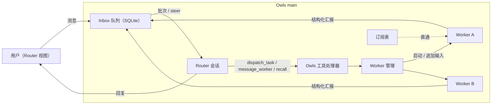

# RFC: Owls Router/Worker（Super-agent）架构

状态：M0 完成，待评审。日期：2026-11-02。

Owls 基线：`e7a9282`（Claude Code runtime 合入后）。
实测版本：Codex CLI `0.148.0`、Claude Code `2.1.316`、Agent SDK `0.3.316`。

本文借鉴 DeepSeek《Super-agent 设计探索：迈向更自主的 Agent 系统》
（[知乎](https://zhuanlan.zhihu.com/p/2099987320443237060)）的双层架构与事件驱动思想，
落到 Owls 现有的 Codex 与 Claude Code runtime 上。文章其余模块（多信道、存算分离、
Watchdog、投机执行）作为后续事件源或独立阶段，不在本 RFC 的 M1–M4 范围内。

## 1. 决策摘要

1. 在现有任务会话之上增加一个常驻 **Router**，每个项目一个。用户和 Router 对话；
   Router 不直接执行任务，而是分派 **Worker**，Worker 就是现有的 Codex 或 Claude Code
   任务会话。
2. Router 与 Worker **互不感知**，所有通信都经 Owls main 进程中转，并持久化在 SQLite。
3. Router 通过 Owls 提供的窄工具（`dispatch_task` 等）行动；Worker 用结构化格式汇报，
   汇报作为事件进入 Router 的 Inbox，按批次注入。
4. **Router 引擎首选 Claude Code**，通过 SDK 进程内 MCP 工具实现，不依赖实验接口，
   并且实测可做到只暴露 Owls 工具。Codex 作为备选 Router，通过实验性 `dynamicTools`
   实现。Worker 两种引擎都支持。
5. 不新增运行时环境变量，不新增常驻 daemon；状态与配置走现有 settings store 和
   `owls-codex.db`。

## 2. 目标与非目标

目标：

- 用户在一个对话里同时推进多件事，不必手动在多个任务之间切换和同步上下文。
- Router 只看摘要，Worker 只看自己的任务，彼此的上下文互相隔离。
- 关键状态持久化，app 重启后 Router、Inbox、Worker 关系都能恢复。

非目标（本 RFC 范围内）：

- 外部信源（IM、GitHub、CI）、对外发言、Watchdog、投机执行、云端运行或 BYOM。
- Worker 之间直接通信。
- 自动 git worktree 管理（M3 之后单独设计）。

## 3. 架构



### 3.1 四条通信路径

| 路径 | 机制 |
| --- | --- |
| Router → Worker（分派） | Router 调用 `dispatch_task`。Owls 创建 Worker 任务并发出第一轮，**立即返回 `workerId`**，不等待任务完成 |
| Worker → Router（汇报） | Worker 每轮的最终输出受 schema 约束；Owls 把它转成 Inbox 事件，进入下一个 Router 批次 |
| 事件 → Worker（订阅直通） | 已订阅的 EventThread，后续事件由 Owls 程序直接投给 Worker，不经过 Router 的 LLM。本 RFC 内的事件源只有用户在 Worker 视图里的追问 |
| Worker ↔ Worker | 不直接通信；跨任务协同由 Router 中转 |

Router 另有一个召回通道：`recall(id)` 按 ID 逐跳展开 Worker、事件或 EventThread 的摘要。

## 4. 原生能力实测（M0）

所有实测都在临时目录中用本机 CLI 和登录账号完成。每项各运行一次，耗时只作量级参考，
包含模型网络延迟。

| 能力 | Codex 0.148.0 | Claude Code 2.1.316 / SDK 0.3.316 |
| --- | --- | --- |
| Router 调用 Owls 工具 | ✅ `thread/start.dynamicTools`；Codex 发 `item/tool/call` 请求，客户端回 `{contentItems, success}`；item 类型为 `dynamicToolCall`。需在 `initialize` 声明 `experimentalApi: true`，否则 `thread/start` 明确报错 | ✅ `createSdkMcpServer` + `tool()` 进程内工具，经 `allowedTools` 自动批准，不触发审批 |
| 工具失败的表达 | ✅ `success: false`，模型按失败原因作答 | ✅ `isError: true`，同样按失败原因作答 |
| Router 隔离（只暴露 Owls 工具） | ⚠️ 未验证。Router 仍带原生 shell；`sandbox: read-only` 只限制写入 | ✅ `tools: []` + `settingSources: []` + 自定义 `systemPrompt`：init 中可用工具只有 `mcp__owls__dispatch_task` |
| 运行中注入（全双工） | ✅ `turn/steer`，在命令执行中注入，**同一 turn** 内生效；`expectedTurnId` 不匹配时被拒绝并给出实际 turn ID | ✅ 在输入流中追加用户消息，在 Bash 执行中注入，**同一 turn** 内生效（只有一个 result）。默认与 `priority: 'next'` 表现相同；`priority` 字段无官方文档 |
| Worker 结构化汇报 | ✅ `turn/start.outputSchema`；最终 `agentMessage` 是合法 JSON | ✅ `outputFormat: { type: 'json_schema' }`；`result.structured_output` 直接是解析后的对象 |
| 并发 | ✅ 同一 app-server 进程内两个 thread 并行（两个 5 秒命令分别在 16 秒、18.6 秒完成） | ✅ 两个 query 并行（10.7 秒、10.8 秒完成） |
| Router 重启后保留工具 | ✅ 非 ephemeral thread 会持久化 `dynamicTools`：新进程 `thread/resume`（该接口没有 `dynamicTools` 参数）后，工具调用仍然生效 | ✅ 每次 query 重新注册进程内工具，`resume` 后同一 session 中工具生效 |

证据：

- 回放 fixtures：`apps/pichu-client/tests/fixtures/providers/`（已脱敏，说明见其 README）。
- 每条发现的复现方式、影响和后续：[实测发现记录](SUPER_AGENT_FINDINGS.md)。
- 所有探针在一次运行中全部通过。Codex 首次运行遇到两个环境问题：本机配置的默认模型
  不支持该账号（`model_not_found`），以及一次性的 `429`（账号周用量 8%，未达上限）。
  显式指定账号默认模型并逐项运行后全部通过。

### 4.1 Router 引擎选择

选择 **Claude Code** 作为默认 Router 引擎：

- 用的是稳定公开接口，而 Codex 的 `dynamicTools` 属于实验接口。
- 隔离已经实测：Router 只能调用 Owls 工具，没有 shell、文件和网络能力。
- 工具在每次 query 时由 Owls 注册，不依赖原生存储保留工具定义。

Codex Router 作为备选：只装了 Codex 时可用，要求 `experimentalApi`，并在 adapter 内做
版本门槛检查。Router 的隔离方式需要另行验证（见第 11 节）。

Router adapter 接口与引擎无关，M1 先实现 Claude Code Router。

## 5. Owls 工具契约（Router 可用）

工具是面向模型的契约：输入输出最小、稳定、确定，列表类结果按固定顺序排序。

| 工具 | 输入 | 输出 |
| --- | --- | --- |
| `dispatch_task` | `goal`；可选 `context`、`provider`、`permission` | `{ workerId, status: 'started' }`；或错误码 `worker_limit_reached`、`permission_not_allowed`、`provider_unavailable`、`invalid_request` |
| `message_worker` | `workerId`、`text` | `{ delivered: 'steered' \| 'queued' }`；或 `worker_not_found`、`worker_closed` |
| `stop_worker` | `workerId` | `{ status: 'stopping' \| 'already_idle' }` |
| `list_workers` | 可选 `status` | 按 `updatedAt` 倒序的 `{ workerId, goal, status, report }` 列表，`report.summary` 截断为 300 字符 |
| `recall` | `id`（worker、事件、批次或 EventThread） | 对象摘要加关联对象 ID，长内容截断并附续读 ID |

约束：

- 工具处理器在 main 进程内，按 Router 会话身份确定项目范围；不信任模型传入的项目或路径。
- `dispatch_task` 不能超过 Router 配置的最高权限；未指定时使用项目默认权限。
- Router 的普通回复文本就是给用户看的回复；对外信道属于后续阶段。

## 6. Worker 汇报契约

```json
{
  "status": "done | blocked | needs_input | progress",
  "summary": "≤ 1000 字符",
  "artifacts": [{ "kind": "file | url | note", "ref": "string" }]
}
```

- Codex Worker 通过 `outputSchema`，Claude Code Worker 通过 `outputFormat` 约束。
- Worker 视图中，最终汇报以卡片展示，而不是原始 JSON。
- 汇报解析失败时生成一条 `status: 'progress'` 的降级事件，并附带原始文本前 500 字符；
  不重试，也不阻塞 Router。

## 7. Inbox、批处理与注入

Inbox 事件来源：用户发给 Router 的消息、Worker 汇报、Worker 的状态变化（等待审批、
失败、被停止），以及 Owls 系统通知。

规则：

1. 事件先写入 SQLite 并获得全局递增 `seq`，再参与投递。
2. Router 空闲时，取出该 Router 的全部待处理事件，按 `seq` 排序，渲染成一条输入，
   作为一个批次发送。
3. Router 运行中：
   - 用户消息立即注入当前 turn（Codex 用 `turn/steer`，Claude Code 在输入流中追加），
     以保证响应及时；
   - 其他事件留到下一批次，避免 Router 的单个 turn 无限延长。
4. 渲染格式确定：每个事件一行头（`[seq] kind source time id`）加摘要；超过上限的内容
   截断，并附 `recall` 所需的 ID。
5. 批次在发送前持久化。发送结果未知（进程崩溃、超时）时标记 `dispatch_unknown`，
   不自动重发。

## 8. 数据模型

新增表放在 `drizzle-codex/` 下，用 forward-only 迁移。逻辑模型如下，评审时可以合并小表，
但不能合并掉身份和事务边界。

| 表 | 关键字段 |
| --- | --- |
| `routers` | `id`、`projectId`、`provider`、`nativeSessionId`、`model`、`maxPermission`、`status`、时间戳 |
| `workers` | `id`、`routerId`、`sessionId`（现有任务）、`goal`、`status`、`lastReport`（JSON）、时间戳 |
| `inbox_events` | `seq`（自增）、`id`、`routerId`、`kind`、`source`、`eventThreadId`、`payload`（JSON）、`status`（`pending` / `batched` / `dropped`）、`batchId` |
| `router_batches` | `id`、`routerId`、`status`（`sending` / `delivered` / `dispatch_unknown`）、时间戳 |
| `event_threads` | `id`、`routerId`、`key`（唯一）、`summary` |
| `subscriptions` | `workerId`、`eventThreadId`（联合主键） |

Worker 状态：`starting → running → reported → idle`，另有 `waiting`（等待审批）、
`stopped`、`failed`。`reported` 指收到汇报后、Router 还没处理该汇报的状态。

## 9. 隔离与安全

M0 发现，用户的全局配置会进入原生会话（详见[实测发现记录](SUPER_AGENT_FINDINGS.md) F1–F3）：

- Codex：用户级 MCP server 和 SessionStart hook 会在 Router/Worker thread 中启动；
  一个结构化汇报的 `summary` 里混入了用户个人全局指令的内容。
- Claude Code：即使设置 `settingSources: []`，内联插件、skills 和 slash commands 仍会加载；
  真正限制住 Router 能力的是 `tools: []`。

对策：

| 角色 | 策略 |
| --- | --- |
| Router（Claude Code） | `tools: []` + `allowedTools` 只放 Owls 工具 + `settingSources: []` + 自定义 `systemPrompt`。隔离依赖**工具白名单**，不依赖 settings |
| Router（Codex） | `sandbox: read-only` + `developerInstructions`；如何屏蔽 shell 和用户级 MCP 需另行验证。验证前 Codex Router 默认关闭 |
| Worker | 保留用户的开发环境配置（这正是用户期望的 agent 行为），用汇报 schema 保证输出可解析；权限取任务自身的权限设置 |

其他约束：

- Router 能读到的只有用户消息、Worker 汇报和 Owls 摘要，都按数据渲染，不会被提升为系统指令。
- Worker 发起的审批照常显示在 UI 上，同时作为 Inbox 事件通知 Router，但 Router 不能代替用户批准。
- 全局 Worker 并发上限先定为常量 4；同一 checkout 上会改文件的 Worker 串行执行，
  直到引入 worktree。

## 10. 恢复语义

- Router 会话：重启后用原生 `resume` 续上（两种引擎都已验证工具仍可用）；Inbox 中
  未投递的事件在下一批次发送。
- 批次：`sending` 状态的批次在重启后标记为 `dispatch_unknown`，在 Router 视图中提示用户，
  不自动重发。
- Worker：沿用现有 Codex 和 Claude Code service 的中断与恢复语义；中断时向 Inbox 写一条
  `stopped` 或 `failed` 事件。
- 原生会话丢失：Router 新建会话，并注入一段确定性的状态摘要（活跃 Worker 和最近的汇报）。

## 11. 开放问题

1. Codex Router 的隔离：能否通过 `config` 覆盖或 `baseInstructions` 屏蔽用户级 MCP、
   hooks 和 shell？
2. Claude Code Router 的进程模型：每个批次起一个进程（简单，冷启动约 1–2 秒），还是一个
   常驻 query 持续接收批次（更快，追加的消息天然并入当前 turn）？M1 先按每批次一个进程
   实现，M2 再测量。
3. Claude Code 用户消息 `priority` 字段的语义未公开，实现中不依赖它。
4. Router 视图的产品形态：独立入口，还是作为项目页的默认对话？
5. Router 和 Worker 的 token 成本观测（文章实验中双层架构的缓存读取 token 高于单会话）。

## 12. 实施阶段

| 阶段 | 内容 | 退出标准 |
| --- | --- | --- |
| M1 | Claude Code Router、`dispatch_task`、Worker 汇报、`workers` 与 `routers` 表、Router 视图的最小 UI | 用回放 fixture 和模拟 provider 跑通「消息 → 分派 → 汇报 → 回复」；用本机 CLI 实测一次 |
| M2 | Inbox 持久化、批处理、用户消息注入、`dispatch_unknown`、重启恢复 | 积压的多条汇报合并成一个批次；重启后不丢事件、不重复投递 |
| M3 | `message_worker`、`stop_worker`、`list_workers`、`recall`、订阅直通 | Worker 视图中的追问不经过 Router；Router 决策次数下降 |
| M4 | 消融实验：用模拟 provider 复现文章 7.1 节，对比单会话与双层架构 | 输出 p50/p95 完成时间、Router 决策次数、token 数据 |

M4 之后的候选：Watchdog、投机执行、GitHub 和 IM 信源、Codex Router。

每个阶段都基于最新 `origin/main` 单独开 MR。行为类变更附 changelog fragment；
本 RFC 为 docs-only，`Changelog: N/A`。
